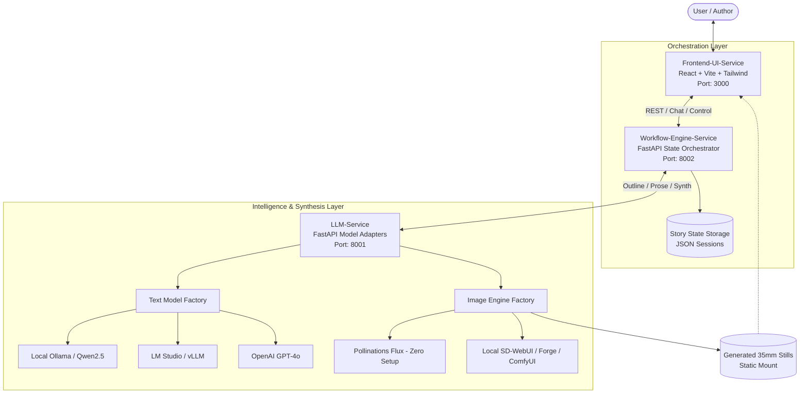

# AI Story Creator 🖋️🎬

> **Microservices-Based AI Narrative & Photorealistic Visual Co-Author Studio**  
> Engineered with Pluggable LLM/Diffusion Model Adapters, LangGraph/FastAPI Orchestration, and a Literary Production Web Studio.

---

## 🌟 Overview

**AI Story Creator** is a full-stack, microservice-powered narrative generation platform and interactive chatbot. It allows authors, game designers, and storytellers to collaborate with an AI Story Director to outline 5-beat story blueprints, write raw and uncensored literary prose, synthesize photography-grade diffusion prompts, and render photorealistic visuals.

The entire architecture is modularized into three decoupled microservices housed within a single monorepo:
1. **`LLM-Service`** (Port `8001`): Model Factory implementing the Adapter pattern for zero-friction swapping between Ollama, LM Studio, OpenAI, vLLM, and Diffusion engines (Pollinations Flux, SD-WebUI, Forge). Hosts the core prompt engines.
2. **`Workflow-Engine-Service`** (Port `8002`): Stateful narrative workflow orchestrator managing 5-beat story lifecycles, chat memory, beat progression, and scene rewrites.
3. **`Frontend-UI-Service`** (Port `3000`): Modern cinematic React/TypeScript web app with chat co-authorship, drop-cap book reader, 35mm photography metadata cards, and live model configuration drawer.

---

## 🏗️ Microservices Architecture



---

## 📁 Monorepo Structure

```text
AIStoryCreator/
├── config.yaml                    # Global model reference (switch model with 1 line)
├── docker-compose.yml             # Single-command multi-container launch
├── run_services.ps1               # PowerShell launcher for all 3 microservices
├── start_services.bat             # Windows CMD launcher
│
├── LLM-Service/                   # Microservice 1: Model Factory & Prompts (Port 8001)
│   ├── config.yaml                # Pluggable model configuration
│   ├── main.py                    # FastAPI server & image static file hosting
│   ├── requirements.txt           # Python dependencies (LangChain, FastAPI, etc.)
│   ├── Dockerfile
│   ├── core/
│   │   ├── prompts.py             # STORY_WRITER, OUTLINER, IMAGE_SYNTHESIZER prompts
│   │   ├── llm_factory.py         # Swappable text models (Ollama, LM Studio, OpenAI)
│   │   └── image_factory.py       # Swappable image models (Pollinations Flux, SD-WebUI)
│   ├── api/
│   │   └── routes.py              # Endpoints for outline, write-scene, image-synth, chat
│   └── tests/
│       └── test_llm_service.py    # Unit tests
│
├── Workflow-Engine-Service/       # Microservice 2: Narrative State Engine (Port 8002)
│   ├── main.py                    # FastAPI orchestration server
│   ├── config.py                  # Service registry & config
│   ├── requirements.txt
│   ├── Dockerfile
│   ├── workflow/
│   │   ├── state.py               # StoryState Pydantic & LangGraph schema
│   │   ├── story_graph.py         # Multi-beat graph & autopilot execution
│   │   └── session_manager.py     # Persistent story session manager
│   ├── api/
│   │   └── routes.py              # Endpoints for start story, next beat, rewrite, autopilot
│   └── tests/
│       └── test_workflow.py       # Unit tests
│
└── Frontend-UI-Service/           # Microservice 3: Cinematic Web Studio (Port 3000)
    ├── package.json
    ├── vite.config.ts             # Vite config with microservice proxy
    ├── tailwind.config.js
    ├── Dockerfile
    ├── index.html
    └── src/
        ├── App.tsx                # Main Studio layout & state
        ├── index.css              # Custom literary serif typography & styling
        ├── components/
        │   ├── ChatInterface.tsx      # Co-Author chatbot with quick premise chips
        │   ├── StoryReader.tsx        # Literary drop-cap manuscript reader
        │   ├── SceneVisualizer.tsx    # 35mm photograph showcase & prompt viewer
        │   ├── BeatProgress.tsx       # 5-beat interactive stepper
        │   ├── CharacterCards.tsx     # Dramatis Personae & World backdrop
        │   └── ModelSettingsModal.tsx # Dynamic model switcher modal
        ├── services/
        │   └── api.ts                 # Typed microservice client
        └── types/
            └── story.ts
```

---

## 🧠 Part 1: Core Prompts & Narrative Principles

### 1. Creative Story Writer (`STORY_WRITER_PROMPT`)
- **Show, Don't Tell**: Sensory reality—textures, scents, shifting light, ambient sounds.
- **Uncensored & Authentic**: Never sanitizes psychological tension, visceral combat, gritty realities, or dark themes.
- **Rhythm & Cadence**: Short punchy sentences for shock/action; lyrical layered prose for atmosphere.
- **Character-Driven Dialogue**: Subtext, colloquial quirks, hidden motivations.
- **Narrative Momentum**: Natural chapter hooks.

### 2. Story Architect / Outliner (`OUTLINER_PROMPT`)
Generates a structured 5-beat JSON narrative blueprint:
- Act 1: The Inciting Disturbance
- Act 2: Rising Complications
- Act 3: The Turning Point
- Act 4: The Climax
- Act 5: The Aftermath & Echo
- Complete character appearances (essential for image generation) and internal flaws.

### 3. Photorealistic Image Prompt Synthesizer (`IMAGE_PROMPT_SYNTHESIZER`)
Translates story prose into cinematographic diffusion prompts:
- **Style**: 35mm film photograph, documentary cinematic shot, medium format.
- **Composition**: Camera framing (close-up, low-angle, shallow depth of field).
- **Lighting**: Natural diffused daylight, golden hour rim lighting, chiaroscuro.
- **Film Details**: Kodak Portra 400 or CineStill 800T, authentic human skin pores, micro-textures, fabric folds.

---

## ⚙️ Part 2: Pluggable Model Architecture (Factory Pattern)

Switch text or image models seamlessly in `LLM-Service/config.yaml` or directly inside the UI Drawer:

```yaml
# Toggle models effortlessly
text_model:
  provider: "ollama"           # Options: "ollama", "lmstudio", "openai", "vllm", "mock"
  model_name: "qwen2.5:3b"     # e.g., "qwen2.5:3b", "gpt-4o-mini", "llama3.2"
  base_url: "http://localhost:11434"
  temperature: 0.8

image_model:
  provider: "pollinations"     # Options: "pollinations" (free Flux), "sd_webui", "forge"
  model_name: "flux"           # e.g., "flux", "turbo"
  output_dir: "./generated_images"
```

---

## 🚀 Quickstart Guide

### Option 1: Native Windows Launcher (Recommended)

1. **Clone the repository:**
   ```bash
   git clone https://github.com/BhanuBurman/AIStoryCreator.git
   cd AIStoryCreator
   ```

2. **Run all 3 services concurrently:**
   ```powershell
   # PowerShell
   .\run_services.ps1
   ```
   Or double-click `start_services.bat`.

3. **Open the Web Studio:**
   - Frontend Studio: [http://localhost:3000](http://localhost:3000)
   - LLM-Service Swagger: [http://localhost:8001/docs](http://localhost:8001/docs)
   - Workflow Engine Swagger: [http://localhost:8002/docs](http://localhost:8002/docs)

### Option 2: Docker Compose

```bash
docker-compose up --build
```

---

## 🧪 Testing

Run automated unit tests across services:

```powershell
# Test LLM-Service
.\.venv\Scripts\python.exe LLM-Service/tests/test_llm_service.py

# Test Workflow Engine
.\.venv\Scripts\python.exe Workflow-Engine-Service/tests/test_workflow.py

# Test Frontend Build
cd Frontend-UI-Service
npm run build
```

---

## 📄 License
MIT License. Created by Bhanu Burman.
